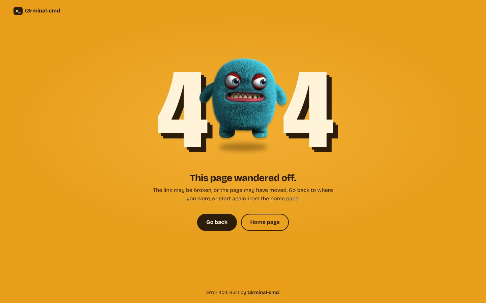
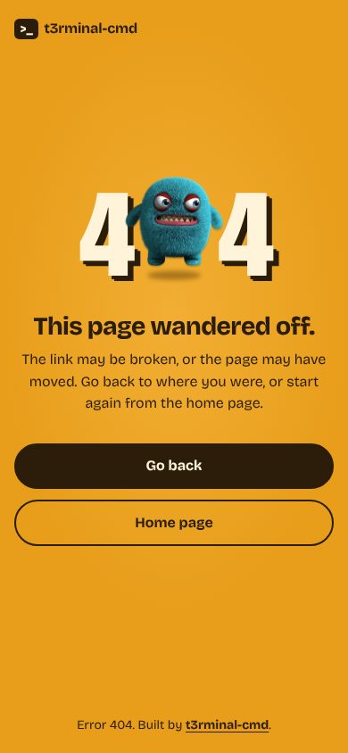

# Error 404 Page

A friendly "page not found" page. A fuzzy teal monster stands in for the zero in a giant **404**, floating over its own shadow, with a short message and two ways out.

**Live:** https://t3rminal-cmd.github.io/Error-404-Page/
(Any missing address on the site shows it too, for example https://t3rminal-cmd.github.io/Error-404-Page/nothing-here)

<p>
  
  
</p>

## Features
- **One clear message.** "This page wandered off," a plain explanation, and two buttons: **Go back** and **Home page**.
- **Go back that always works.** It returns to the previous page. With no history (a link opened in a new tab) or no JavaScript, it goes to the home page instead.
- **Mobile first.** The 404 scales with the screen, the buttons go full width on small phones, and short landscape screens get a smaller headline.
- **One animation.** The monster floats and its shadow shrinks and grows with it. Both stop when the device asks for reduced motion.
- **Accessible.** The heading reads as "Error 404" to screen readers, there's a skip link, keyboard focus is clearly visible, and the text colors pass WCAG AA contrast.
- **Fast.** No frameworks and no CDNs. The font, image and icon are all in this repo (about 230 KB in total).

## Project layout
```
index.html               The page
assets/css/styles.css    Colors, type, layout and the float animation
assets/js/main.js        The Go back button
assets/fonts/            Bricolage Grotesque (SIL Open Font License, see OFL.txt)
assets/img/              The monster, in two sizes
assets/icons/            Favicon
.github/workflows/       Publishes the site to GitHub Pages
```

## Run locally
```bash
git clone https://github.com/t3rminal-cmd/Error-404-Page.git
cd Error-404-Page
python3 -m http.server 8000
# open http://localhost:8000
```

## Use it on your own site
1. Copy `index.html` and `assets/` into your site and rename `index.html` to `404.html`.
2. Change the two button links (and the brand link in the header) from the portfolio address to your own home page.
3. If the page can be served from nested addresses, make the `assets/` paths absolute (start them with `/`) so the styles and image still load.

Most hosts pick up `404.html` automatically, including GitHub Pages.

## Customizing
| To change… | Edit |
|---|---|
| Colors | The variables at the top of `assets/css/styles.css` |
| Message and button text | `index.html` |
| Size of the 404 | `--code-size` in `assets/css/styles.css` |
| The monster | Replace `assets/img/monster.webp` (and `monster-sm.webp` at half size). A transparent image cropped close to the character works best. |

## Deploying
Every push to `main` runs **Deploy Site** (`.github/workflows/pages.yml`). It publishes the page as both `index.html` and `404.html`, the second with absolute asset paths so it works at any address.

One-time setup: Settings → Pages → Build and deployment → Source: **GitHub Actions**.

## License
[MIT](LICENSE). The font is Bricolage Grotesque, under the SIL Open Font License.
